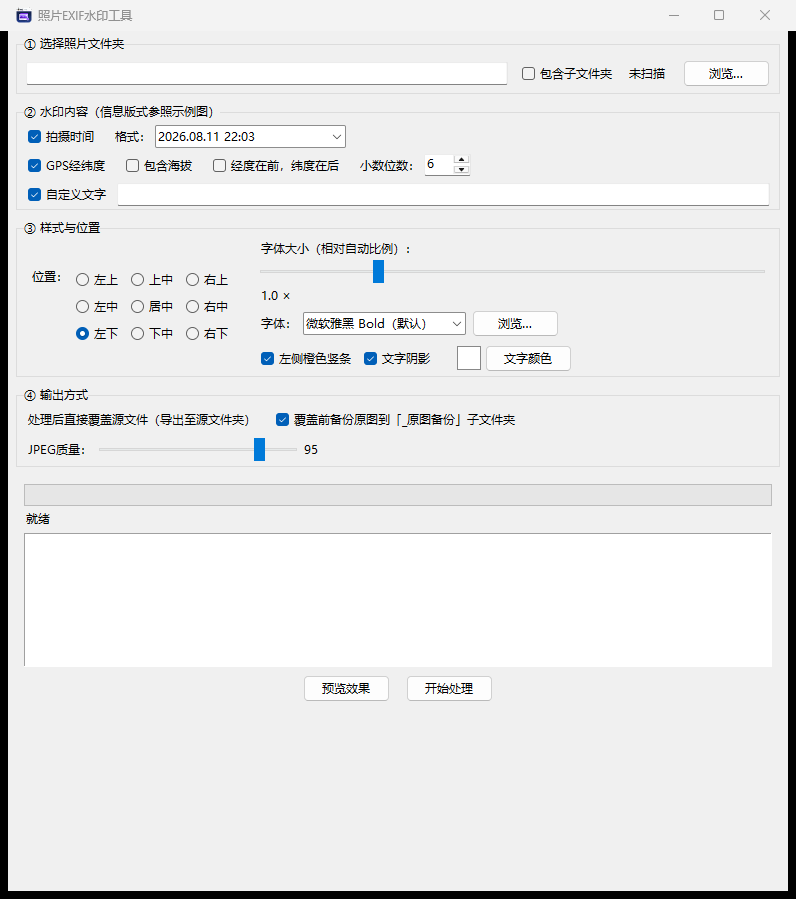
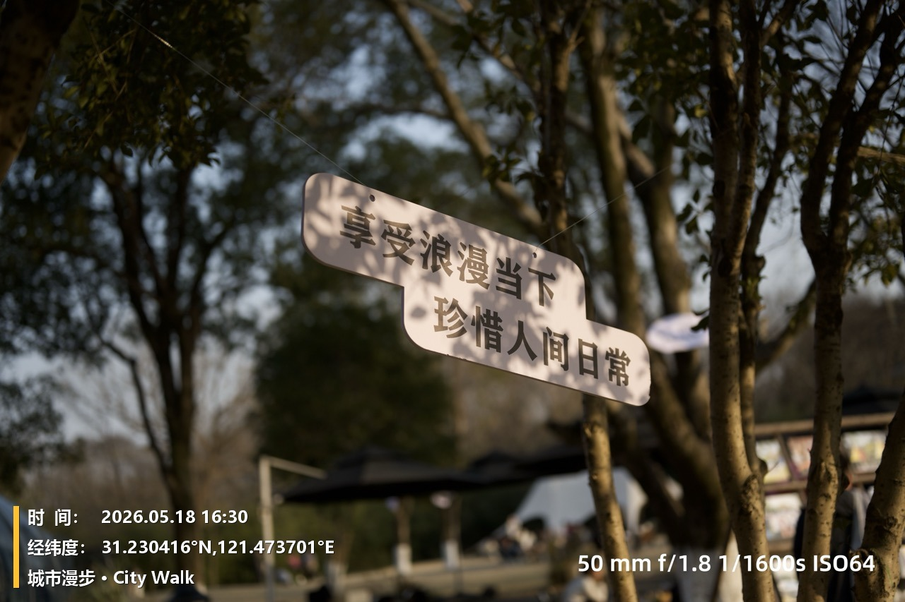

<div align="center">
  
  <h1>照片 EXIF 水印工具</h1>
  <p><strong>Photo EXIF Watermark</strong></p>
  <p>把拍摄时间、GPS 经纬度、海拔和自定义文字批量写入照片的 Windows 桌面工具。</p>
  <p>A Windows desktop app for adding EXIF time, GPS, altitude, and custom text to photos in batches.</p>
  <p>
    <a href="#简体中文">简体中文</a> ·
    <a href="#english">English</a> ·
    <a href="https://github.com/SoulRui/photo-exif-watermark/releases/latest"><strong>下载 Windows 版 / Download</strong></a>
  </p>
  <p>
    
    
    
  </p>
</div>

> **注意 / Important：** 本工具会在处理后覆盖源照片，并非“另存为”。请保留默认的原图备份选项，重要照片建议先额外备份。 / The app overwrites source photos instead of saving to a separate output folder. Keep the backup option enabled and make an additional copy of important photos.

---

## 简体中文

### 这是什么？

照片 EXIF 水印工具是一款免安装、批量处理的 Windows 小工具。它读取照片自带的 EXIF 信息，将拍摄时间、GPS 经纬度、海拔以及你输入的文字，以“橙色竖条 + 白色粗体字 + 阴影”的样式绘制到照片上。

适合工程记录、无人机航拍、外业调研、旅行整理和照片归档。所有图片处理都在本机完成，无需注册账号，也不会把照片上传到服务器。

**软件界面目前为简体中文，本主页同时提供英文说明。**

### 界面与效果

<p align="center">
  
</p>

<p align="center">
  
  <br>
  <sub>示例中的日期、坐标和自定义文字仅用于演示；发布用示例图不包含原始 EXIF 元数据。</sub>
</p>

### 下载与运行

1. 打开本仓库的 **[Releases 页面](https://github.com/SoulRui/photo-exif-watermark/releases/latest)**。
2. 下载 **`photo-exif-watermark-v1.0.0-windows-x64.exe`**。
3. 双击运行，无需安装 Python 或其他运行环境。
4. 发布文件为 **Windows 64 位免安装程序**。软件没有购买代码签名证书，Windows SmartScreen 可能显示提示；请只从本仓库 Releases 下载，并核对发布页提供的 SHA-256 校验值。也可以在核对源码后选择从源码运行。

校验命令（Windows PowerShell 或命令提示符）：

```powershell
certutil -hashfile "photo-exif-watermark-v1.0.0-windows-x64.exe" SHA256
```

### 快速上手

1. **选择照片文件夹**：点击“浏览…”，程序会统计支持的图片数量；需要处理子目录时勾选“包含子文件夹”。
2. **选择水印内容**：按需勾选拍摄时间、GPS 经纬度、海拔和自定义文字。
3. **设置样式与位置**：选择九宫格位置、字体、字号比例、文字颜色，以及是否显示橙色竖条和阴影。
4. **检查输出选项**：默认覆盖源文件，并在覆盖前备份到源文件夹下的 `_原图备份`。JPEG 质量默认为 95。
5. **先预览**：点击“预览效果”查看当前文件夹第一张照片的效果。预览不会修改照片。
6. **开始处理**：确认提示后点击“开始处理”，通过进度条和日志查看每张图片的处理结果。

> 请先用少量照片副本试跑，确认字体、位置、时间和 GPS 符合预期，再处理整个相册。

### 功能一览

| 功能 | 说明 |
| --- | --- |
| 批量处理 | 扫描整个文件夹，也可包含所有子文件夹；显示处理进度和逐文件日志。 |
| 拍摄时间 | 优先读取 EXIF 原始拍摄时间，提供 6 种显示格式。 |
| GPS 与海拔 | 显示经纬度和南北纬/东西经标记；支持坐标顺序、小数位数和海拔设置。 |
| 自定义文字 | 添加项目名称、地点说明、作者署名等单行文字。 |
| 九宫格定位 | 左上、上中、右上、左中、居中、右中、左下、下中、右下。 |
| 字体与排版 | 自动列出可用的常见 Windows 字体，也可选择 `.ttf`、`.ttc`、`.otf` 字体文件。 |
| 中文回退 | 使用 Arial 等西文字体时，可检测中文字形缺失，并让中文与西文分别使用合适字体、保持基线对齐。 |
| 自适应样式 | 字号随照片短边自动缩放，可进一步调整比例；支持文字颜色、橙色竖条及阴影开关。 |
| 方向处理 | 按 EXIF 方向先旋转照片，再绘制水印，避免水印落到错误方向。 |
| 本地处理 | 不依赖在线服务，照片不会由本工具上传到网络。 |

### 选项说明

| 选项 | 范围或行为 |
| --- | --- |
| 时间格式 | `2026.08.11 22:03`、`2026.08.11 22:03:45`、`2026-08-11 22:03`、`2026-08-11 22:03:45`、`2026年08月11日 22:03`、`2026/08/11 22:03` |
| GPS 小数位数 | 2–10 位，默认 6 位。 |
| 坐标顺序 | 默认纬度在前；可切换为经度在前。 |
| 海拔 | 以米为单位显示，保留 1 位小数；正确处理低于海平面的负海拔。 |
| 字号比例 | 0.4–3.0 倍；1.0 倍约为照片短边的 3.1%。 |
| JPEG 质量 | 70–100，默认 95。该设置也用于 WebP 保存质量。 |
| 输出方式 | 使用临时文件保存后替换源文件；可在替换前备份原图。 |

### EXIF 读取规则

| 内容 | 读取与处理方式 |
| --- | --- |
| 拍摄时间 | 优先读取 `DateTimeOriginal`，其次读取 `DateTimeDigitized`，再读取普通 `DateTime`。 |
| 无 EXIF 时间 | 使用文件修改时间，因此显示的不一定是真实拍摄时间。 |
| GPS | 从 EXIF GPS 字段读取经纬度及方向参考；缺少完整 GPS 时自动跳过该行。 |
| 海拔 | 从 GPS 海拔字段读取；没有海拔数据时不显示该行。 |
| 照片方向 | 根据 EXIF 方向自动转正，并在支持的格式中把输出方向标记规范化为 1。 |
| 元数据保留 | 对 JPEG、WebP、TIFF 尽可能保留原有 EXIF 和 DPI；不同编码器的支持程度可能不同，重要照片请保留备份。 |

### 支持的图片格式

- 扩展名：`.jpg`、`.jpeg`、`.png`、`.bmp`、`.tif`、`.tiff`、`.webp`。
- 输出会转换为 **RGB 静态图片**；PNG 等图片的透明通道不会保留。
- 动图、多页 TIFF 等多帧图片只处理当前帧，不会逐帧生成动画或多页文件。
- JPEG 和 WebP 会重新编码，即使质量设为 95 或更高，也不等于无损处理。
- 工具主要为 Windows 设计；在其他系统从源码运行时，需要自行适配字体路径。

### 输出、备份与隐私

**覆盖源文件不可逆。** 默认备份目录为源文件夹下的 `_原图备份`，每个源文件在第一次处理前复制一份；已有同名备份不会被再次覆盖。

递归处理时需要特别注意：

- `_原图备份` 位于源目录内，再次扫描并启用“包含子文件夹”时，备份图片也可能进入处理列表。重复处理前建议先将备份目录移到扫描范围之外。
- 递归模式会把备份按文件名集中放在同一个备份目录中。不同子目录里的同名文件不会分别保留备份，因此重要任务请额外备份整个原始目录。
- 本工具不会移除已有水印，也不能自动撤销已经写入的水印；需要恢复时请使用处理前的原图备份。

照片和 EXIF 均在本机处理，但 **GPS 水印和保留下来的 EXIF 可能暴露拍摄地点**。公开发布处理后的照片前，请检查图片上的坐标及文件元数据。

### 从源码运行

要求：64 位 Windows、Python 3.10 或更高版本，以及 Python 自带的 tkinter。

在项目根目录执行（PowerShell）：

```powershell
py -m venv .venv
.\.venv\Scripts\Activate.ps1
python -m pip install -r requirements.txt
python app\photo_watermark.py
```

`requirements.txt` 包含 Pillow 和 fontTools；后者用于检测字体是否包含所需中文字形。

### 自行打包 EXE

先按上一节创建虚拟环境并安装运行依赖，再执行：

```powershell
python -m pip install PyInstaller
cd app
pyinstaller --clean "照片EXIF水印工具.spec"
```

打包结果位于 `app/dist/照片EXIF水印工具.exe`。项目已经提供 `.spec` 配置和图标，不需要手动填写 PyInstaller 参数。

### 命令行自检

程序提供自检入口，用于验证 EXE 的图片处理能力：

```powershell
.\photo-exif-watermark-v1.0.0-windows-x64.exe --selftest "D:\Photos\TestCopy"
```

也可指定字体，以及切换为经度在前：

```powershell
.\photo-exif-watermark-v1.0.0-windows-x64.exe --selftest "D:\Photos\TestCopy" "C:\Windows\Fonts\arial.ttf" lonfirst
```

自检会在目标文件夹写入 `_selftest_log.txt`，返回码 `0` 表示所有图片处理成功，非 `0` 表示失败或没有找到图片。

> **警告：自检模式不备份原图，并会直接覆盖目标文件夹中的图片。只对测试副本使用。** 目前没有面向日常批处理的完整 CLI 参数集。

### 项目结构

```text
photo-exif-watermark/
├── app/
│   ├── photo_watermark.py       # EXIF 读取、水印绘制、GUI 与自检
│   ├── 照片EXIF水印工具.spec     # PyInstaller 打包配置
│   ├── icon.ico                 # EXE 图标
│   └── icon.png                 # 主页图标
├── docs/images/                 # 界面截图和已清除 EXIF 的效果示例
├── 使用说明.txt                  # 中文快速说明
├── requirements.txt             # Python 运行依赖
└── README.md                    # 中英文主页
```

### 常见问题

**为什么没有时间或 GPS 行？**

有可用时间时会显示时间；如果照片没有 EXIF 时间，程序会使用文件修改时间。GPS 或海拔字段不完整时，对应行会被跳过。

**预览会修改照片吗？**

不会。只有点击“开始处理”并确认后，程序才会写入文件。

**可以只添加自己的文字吗？**

可以。取消选择时间、GPS 和海拔，仅保留“自定义文字”并输入内容。

**为什么处理后画质变化或透明背景消失？**

JPEG/WebP 会重新编码；所有输出都会转换为 RGB，透明通道和多帧内容不会保留。请先备份并检查输出。

**如何反馈问题？**

欢迎在 GitHub Issues 中说明 Windows 版本、图片格式、操作步骤和报错日志。请不要上传包含个人隐私或真实 GPS 的原图，可先制作脱敏副本。

### 许可

本项目目前尚未单独指定开源许可证。在添加许可证前，公开源代码不等同于授予复制、修改或再分发的开源授权。

---

## English

### Overview

Photo EXIF Watermark is a portable Windows desktop app that reads EXIF metadata and draws capture time, GPS coordinates, altitude, and custom text directly onto photos in batches. Its default style combines an amber vertical bar, bold white text, and a subtle shadow.

It is useful for field work, engineering records, drone photography, travel albums, and photo archives. Processing is performed locally: no account is required, and the app does not upload your photos to a server.

**The user interface is currently in Simplified Chinese; this README provides full English documentation.**

### Screenshots

<p align="center">
  
</p>

<p align="center">
  
  <br>
  <sub>The date, coordinates, and custom text are demonstration values. The published example contains no original EXIF metadata.</sub>
</p>

### Download and run

1. Open the repository's **[Releases page](https://github.com/SoulRui/photo-exif-watermark/releases/latest)**.
2. Download **`photo-exif-watermark-v1.0.0-windows-x64.exe`**.
3. Double-click the file. Python and additional runtimes are not required.
4. The release is a **portable 64-bit Windows executable**. It is not digitally signed with a purchased code-signing certificate, so SmartScreen may show a warning. Download only from this repository's Releases page and compare the SHA-256 hash provided in the release notes. Alternatively, inspect and run the source code yourself.

Verify the downloaded file in PowerShell or Command Prompt:

```powershell
certutil -hashfile "photo-exif-watermark-v1.0.0-windows-x64.exe" SHA256
```

### Quick start

1. **Choose a photo folder**: click “浏览…” (Browse). Enable “包含子文件夹” to include subfolders.
2. **Choose watermark content**: capture time, GPS coordinates, altitude, and/or custom text.
3. **Adjust the style**: select one of nine positions, a font, size scale, text color, the amber bar, and shadow.
4. **Check the output settings**: processing overwrites source files. By default, originals are copied to `_原图备份` under the selected folder first. JPEG quality defaults to 95.
5. **Preview first**: “预览效果” shows the first photo in the current folder without changing it.
6. **Start processing**: confirm the warning, then follow the progress bar and per-file log.

> Try a few copies first. Check the font, position, timestamp, and coordinates before processing an entire photo library.

### Features

| Feature | Description |
| --- | --- |
| Batch processing | Scans a folder, optionally including subfolders, with progress and per-file logs. |
| Capture time | Reads the original EXIF capture time first and offers six display formats. |
| GPS and altitude | Shows coordinates with hemisphere references, configurable precision/order, and optional altitude. |
| Custom text | Adds a project name, location note, author credit, or another single-line caption. |
| Nine positions | Top, center, and bottom rows, each with left, center, and right alignment. |
| Fonts and layout | Lists available common Windows fonts and accepts custom `.ttf`, `.ttc`, and `.otf` files. |
| CJK fallback | Detects missing Chinese glyphs in fonts such as Arial and uses suitable primary/fallback fonts with aligned baselines. |
| Adaptive styling | Scales text from the photo's shorter edge, with manual scale, text color, bar, and shadow controls. |
| Orientation support | Applies EXIF orientation before drawing so the watermark appears in the intended place. |
| Local processing | Does not depend on an online service and does not upload photos. |

### Settings reference

| Setting | Range or behavior |
| --- | --- |
| Time format | `2026.08.11 22:03`, `2026.08.11 22:03:45`, `2026-08-11 22:03`, `2026-08-11 22:03:45`, `2026年08月11日 22:03`, or `2026/08/11 22:03` |
| GPS precision | 2–10 decimal places; 6 by default. |
| Coordinate order | Latitude first by default; longitude-first is available. |
| Altitude | Meters with one decimal place, including negative values below sea level. |
| Font scale | 0.4–3.0×; 1.0× is approximately 3.1% of the shorter image edge. |
| JPEG quality | 70–100; 95 by default. Also used as WebP save quality. |
| Output | Saves to a temporary file and replaces the source; optional backup before replacement. |

### EXIF behavior

| Content | Behavior |
| --- | --- |
| Capture time | Tries `DateTimeOriginal`, then `DateTimeDigitized`, then the general `DateTime` field. |
| Missing EXIF time | Falls back to the file modification time, which may not be the actual capture time. |
| GPS | Reads coordinates and hemisphere references from EXIF GPS fields. Incomplete or missing GPS data omits that line. |
| Altitude | Reads the GPS altitude field and omits the line if no altitude is available. |
| Orientation | Applies EXIF orientation and normalizes the saved orientation tag to 1 for supported formats. |
| Metadata preservation | Attempts to retain existing EXIF and DPI for JPEG, WebP, and TIFF. Encoder support varies; keep backups of important originals. |

### Supported image formats

- Extensions: `.jpg`, `.jpeg`, `.png`, `.bmp`, `.tif`, `.tiff`, and `.webp`.
- Output is converted to a **static RGB image**. Transparency in PNG and other formats is not preserved.
- Only the current frame of an animated or multi-page image is processed; animation and additional pages are not retained.
- JPEG and WebP are re-encoded. A quality setting of 95 or higher does not make processing lossless.
- The app is designed primarily for Windows. Running the source on another desktop OS requires adapting the font paths.

### Output, backups, and privacy

**Overwriting a source photo is irreversible.** By default, the app copies each original to `_原图备份` under the selected folder before its first write. An existing backup with the same filename is not overwritten.

Take extra care with recursive processing:

- Because `_原图备份` is inside the source tree, a later scan with subfolders enabled can include the backup images too. Move the backup folder outside the scanned tree before running another batch.
- Recursive backups are flattened into one directory by filename. Same-named files from different subfolders do not receive separate backups. Make a full additional backup of the original directory for important jobs.
- The app neither removes existing watermarks nor provides an undo operation. Restore a pre-processing backup if you need the original.

Photos and EXIF data are processed locally, but **visible GPS watermarks and preserved EXIF metadata can reveal where a photo was taken**. Review both before publishing an image online.

### Run from source

Requirements: 64-bit Windows, Python 3.10 or later, and the tkinter module bundled with standard Python distributions.

From the repository root in PowerShell:

```powershell
py -m venv .venv
.\.venv\Scripts\Activate.ps1
python -m pip install -r requirements.txt
python app\photo_watermark.py
```

`requirements.txt` includes Pillow and fontTools. fontTools checks whether the selected font contains the Chinese glyphs needed by the watermark.

### Build the executable

Create the virtual environment and install the runtime dependencies as shown above, then run:

```powershell
python -m pip install PyInstaller
cd app
pyinstaller --clean "照片EXIF水印工具.spec"
```

The executable is written to `app/dist/照片EXIF水印工具.exe`. The repository includes the `.spec` file and icons, so no manual PyInstaller options are needed.

### Command-line self-test

The self-test entry point verifies image processing in the packaged executable:

```powershell
.\photo-exif-watermark-v1.0.0-windows-x64.exe --selftest "D:\Photos\TestCopy"
```

You can also select a font and put longitude before latitude:

```powershell
.\photo-exif-watermark-v1.0.0-windows-x64.exe --selftest "D:\Photos\TestCopy" "C:\Windows\Fonts\arial.ttf" lonfirst
```

The test writes `_selftest_log.txt` in the target folder. Exit code `0` means all images were processed; a nonzero code means a failure or no images found.

> **Warning: self-test mode does not create backups and overwrites images in the target folder. Use test copies only.** A full CLI for ordinary batch processing is not currently provided.

### Project layout

```text
photo-exif-watermark/
├── app/
│   ├── photo_watermark.py       # EXIF reader, renderer, GUI, and self-test
│   ├── 照片EXIF水印工具.spec     # PyInstaller configuration
│   ├── icon.ico                 # Executable icon
│   └── icon.png                 # README icon
├── docs/images/                 # App screenshot and EXIF-stripped example
├── 使用说明.txt                  # Quick Chinese instructions
├── requirements.txt             # Python runtime dependencies
└── README.md                    # Bilingual project homepage
```

### FAQ

**Why is the time or GPS line missing?**

Time is shown when available. If EXIF time is absent, the app uses the file modification time. Missing or incomplete GPS/altitude fields cause their corresponding lines to be omitted.

**Does preview modify a photo?**

No. Files are written only after you start processing and confirm the warning.

**Can I add only custom text?**

Yes. Disable time, GPS, and altitude, then enable custom text and enter your caption.

**Why did quality change or transparency disappear?**

JPEG/WebP output is re-encoded, and all output is converted to RGB. Transparency and additional frames are not preserved. Back up and inspect the results first.

**How can I report an issue?**

Open a GitHub issue with your Windows version, image format, steps to reproduce, and error log. Do not upload originals containing personal information or real GPS coordinates; create a redacted sample instead.

### License

No separate open-source license has been specified yet. Making source code publicly visible does not, by itself, grant open-source rights to copy, modify, or redistribute it.
